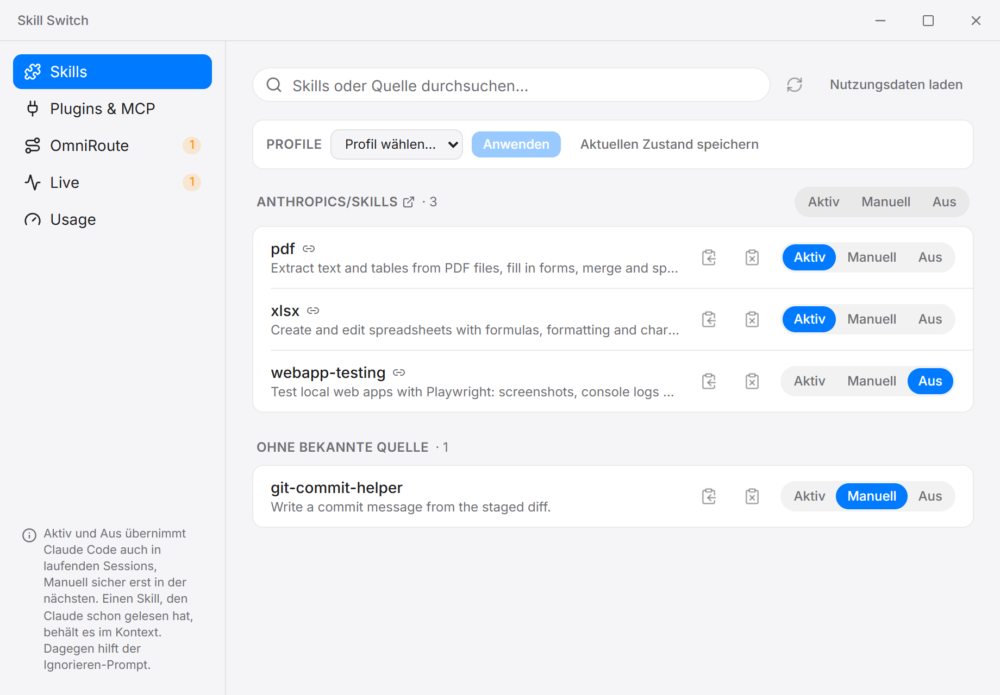

# Skill Switch

[](https://github.com/messlatte/skill-switch/actions/workflows/ci.yml)

Windows desktop app for turning Claude Code skills on and off. It also shows where the usage limit goes and how full the context of running sessions is. Built with Tauri 2, Rust and React. The UI is in German.



## Why

Claude Code puts the name and description of every installed skill into each new session. With a few dozen skills installed, I wanted to switch some of them off for a while without renaming folders or editing `settings.json` by hand. The usage and live tabs came later, when I wanted to know which sessions use up the limit.

## Download

The [latest release](https://github.com/messlatte/skill-switch/releases/latest) has an NSIS installer (about 3 MB) and an MSI. Both are unsigned, so Windows SmartScreen shows "Unknown publisher"; "More info" and then "Run anyway" starts the installer. The app needs the WebView2 runtime, which Windows 11 ships with.

## Features

- **Skills:** lists the skills in `~/.claude/skills` and `~/.claude/skills-disabled` with the description from `SKILL.md`. Each skill has three states:
  - _Aktiv_: Claude sees the skill and can use it on its own.
  - _Manuell_: only callable via `/name`. The app sets `skillOverrides` in `~/.claude/settings.json`.
  - _Aus_: moves the folder to `skills-disabled`. Nothing is deleted.
- **Groups:** if `~/.agents/.skill-lock.json` exists, skills are grouped by the repo they were installed from, with one switch per group.
- **Profiles:** save the current skill states under a name and apply them again later.
- **Plugins & MCP:** read-only list of installed plugins and MCP servers. Once the usage data is loaded, it shows how often each MCP server was used and when it was last used.
- **Usage:** reads the local transcripts in `~/.claude/projects` and shows tokens per day, project and tool. It evaluates token counts, model, effort, tools, skills and project. The text of prompts, responses and tool output is read along with each line but not stored, shown or sent.
- **Live:** running sessions with their current context size and a hint when to compact. Optional Windows notifications, and a hook that warns inside Claude Code shortly before auto-compact.
- **OmniRoute:** sends the Claude Code traffic of selected projects through a local [OmniRoute](https://github.com/cheaper-inference/OmniRoute) proxy by writing to each project's `.claude/settings.local.json`.

Aktiv and Aus reach running sessions too, because Claude Code watches the skill folders ([docs](https://code.claude.com/docs/en/skills)). For Manuell, a new session is the safe bet. A skill that Claude has already read stays in that session's context. The two copy buttons next to each skill put a prompt on the clipboard that tells a running session to use or to ignore that skill.

## How it works

The Rust side in `src-tauri/src` does all file access and exposes a fixed set of commands to the frontend:

- `lib.rs`: skill list, the three states, `settings.json`
- `usage.rs`: parses the JSONL transcripts and aggregates tokens per request, day, project and tool
- `live.rs`: polls the transcripts of active sessions
- `omniroute.rs`: per-project routing and backups
- `profiles.rs`, `hook.rs`: saved profiles and the context-warning hook

The React frontend in `src` has one component per tab. `src/lib/api.ts` wraps the Tauri commands. The frontend itself has no file system access. Beyond Tauri's core defaults it may only close the window, send notifications and open `https://` links.

## Design decisions

- **Tauri and Rust.** File access stays in Rust behind named commands. The UI runs in the WebView2 runtime that ships with Windows, so the installer does not bundle a browser.
- **"Aus" moves the folder.** Claude Code then does not see the skill at all. The move refuses to run if a folder with the same name already exists in the target, so nothing gets overwritten.
- **Only `skillOverrides` is written.** Every other key in `settings.json` stays as it is. Writes are serialized through a mutex, because two quick toggles would otherwise race. They go to a temporary file first, which is then renamed over the original, so a crash cannot leave a half-written file.
- **Linked skills count as skills.** Skills installed by a skills manager are often directory junctions. On Windows, `file_type()` reports a junction as neither file nor directory, so the app resolves the link explicitly; otherwise linked skills would drop out of the list.
- **Usage is deduplicated by `requestId`.** Claude Code writes one API request as several transcript lines with the same `requestId`, so counting lines would multiply the tokens. Tool calls are deduplicated by their id. `requests_are_deduplicated_by_request_id_and_turns_counted` in `usage.rs` tests this.
- **The live tab reads only what is new.** Each poll seeks to where the last one stopped, reads the appended bytes and consumes only complete lines. A line that is still being written waits for the next poll, and a file that got shorter resets the cursor.
- **Backups outside the project.** Before the app changes a project's `settings.local.json`, it keeps the last three versions in its own app data folder. That file can hold the proxy's API key, so a backup must never land inside the project, where Git could pick it up.

## Limitations

- Windows only. The code uses Windows file attributes and process flags.
- The usage and live tabs read Claude Code's transcript format, which is not documented. A format change can break them.

## Development

Requirements: Windows 10 or 11, Node.js 20.19 or later, Rust stable (`x86_64-pc-windows-msvc`) and the Visual Studio Build Tools with "Desktop development with C++".

```bash
npm install
npm run tauri dev
```

`npm run dev` starts only the frontend in the browser, with sample data from `src/lib/mock.ts` instead of the Rust backend.

```bash
npm run tauri build
```

builds the installers into `src-tauri/target/release/bundle/`.

## Tests

```bash
cd src-tauri
cargo test
```

The unit tests sit next to the code in each Rust module. CI runs `cargo fmt --check`, `cargo clippy` with warnings as errors, `cargo test`, the frontend build, `oxlint` and Prettier on pushes to `main` and on pull requests. Pushing a `v*` tag builds the installers and attaches them to a draft release.

## License

[MIT](LICENSE)
